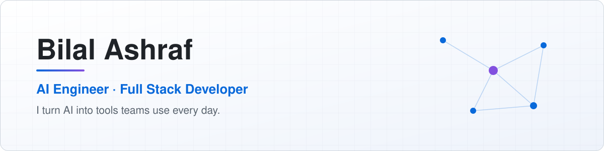

<picture>
  <source media="(prefers-color-scheme: dark)" srcset="assets/banner-dark.svg">
  <source media="(prefers-color-scheme: light)" srcset="assets/banner-light.svg">
  
</picture>

  
  
  
  
  

 

Most teams don't need another AI demo. They need something that works reliably, saves time and fits how people already work. **That's what I build.**

- 💼 **Now:** Full Stack Developer at **Afflix Media**, responsible for the internal platform 30+ team members, clients and creators use every day, plus an AI integration (MCP) that lets the team work with company data by asking in plain language.
- 🛡️ **AI safety:** cut successful jailbreak attacks on an LLM from **100% → 8.75%** with a 3-layer defense pipeline.
- 📄 **Research:** co-author of **H-RADIS**, a published real-time anomaly-detection framework for smart-building IoT.
- 🎯 **Open to:** AI/ML Engineer and Software Engineer roles.

 

## ✨ Featured work

<table>
  <tr>
    <td width="50%" valign="top">
      <h3>🛡️ Adversarial Defense in LLMs</h3>
      
A three-layer pipeline that stops harmful prompts before and after the model: an intent classifier, a QLoRA-tuned TinyLlama, and a zero-shot output check.

      
<b>100% → 8.75%</b> attack success rate · <b>365 / 400</b> jailbreaks blocked · runs on consumer hardware

      

        
        
        
      

      <a href="https://mbilal-72-adversarial-defense-llm.hf.space">Live demo</a> · <a href="https://github.com/MBilal-21/fyp-layered-defense">Code</a>
    </td>
    <td width="50%" valign="top">
      <h3>📄 H-RADIS · Published research</h3>
      
Lightweight edge framework that detects anomalies in real time across many sensor streams in smart buildings. I built the IoT testbed and the data pipeline behind the study's dataset.

      
<b>+26%</b> F1-score · <b>+49%</b> throughput vs. LOF, One-Class SVM and RIVER

      

        
        
        
      

      <a href="https://doi.org/10.53560/PPASA(63-3)720">Read the paper</a> · Proc. Pakistan Academy of Sciences, 2026
    </td>
  </tr>
  <tr>
    <td width="50%" valign="top">
      <h3>🎫 EventGateway</h3>
      
QR-based event check-in that records attendance in real time and rejects duplicate scans, with role-based access and an analytics dashboard for organisers.

      

        
        
        
      

      <a href="https://event-gateway-six.vercel.app">Live demo</a>
    </td>
    <td width="50%" valign="top">
      <h3>📟 ProtectHer · Smart Safety System</h3>
      
A wearable ESP32 device and Android app that send live alerts, GPS location and SOS notifications, with on-device emotion detection.

      

        
        
        
      

      <a href="https://github.com/MBilal-21/ProtecHer-Smart-Safety-Band-FYP">Code</a>
    </td>
  </tr>
</table>

<b>More projects</b>

 

| Project | What it does | Links |
|---|---|---|
| **MedBridge** | AI medication reconciliation across doctor visits | [Code](https://github.com/MBilal-21/medbridge) |
| **SkinSight** | Acne-detection Android app that runs fully on-device, no server needed | — |
| **University Attendance Portal** | Full-stack attendance platform with role-based access | [Live](https://attendance-portal-lovat.vercel.app) · [Code](https://github.com/MBilal-21/attendance-portal) |
| **Clipboard History Manager** | Cross-platform desktop app, packaged for macOS through an automated build pipeline | [Code](https://github.com/MBilal-21/clipboard-history-mac) |
| **Client websites** | Falafel Kabob (Laravel), Majesticon UK (WordPress), Seraphic Medium | [Majesticon](https://majesticon.co.uk) · [Seraphic Medium](https://seraphicmedium.com) |

 

## 🧰 Tech stack

  <b>AI / ML</b> 
  
  &nbsp;Hugging Face Transformers · LLM fine-tuning (QLoRA) · AI agents (MCP) · Claude

  <b>Full stack</b> 
  

  <b>Data &amp; infrastructure</b> 
  

  <b>IoT &amp; mobile</b> 
  

 

## 🏆 Recognition

- 🥈 **2nd Place**, AI Prompt Engineering Competition, Namal Mianwali (2025)
- 🏅 **Top 10 Finalist**, GenAI Hackathon, Pak Angels (2025)
- 🎓 **BS Information Technology**, University of Sargodha (CGPA 3.51)

 

  Looking for someone who turns AI into something people actually use? <a href="https://www.linkedin.com/in/bilalashraf72/">Let's talk on LinkedIn</a>.

